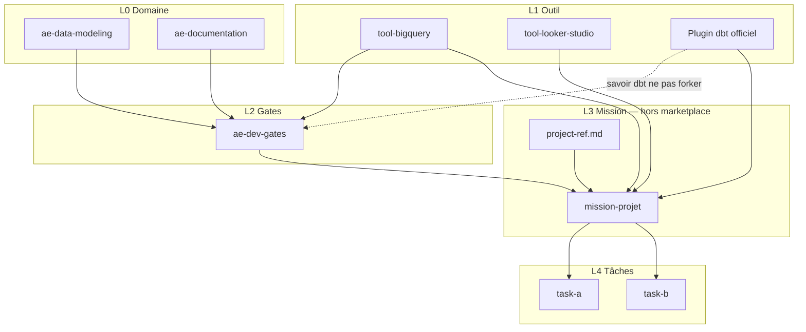
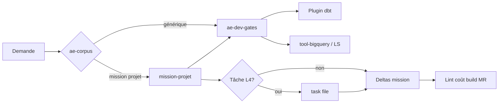
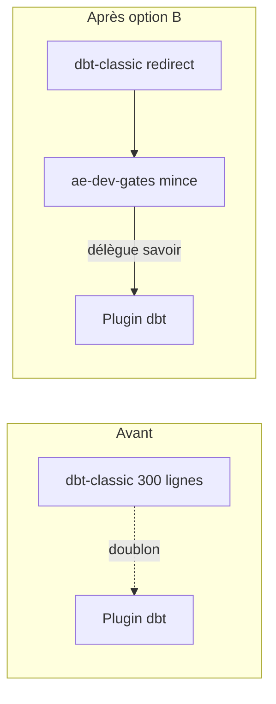
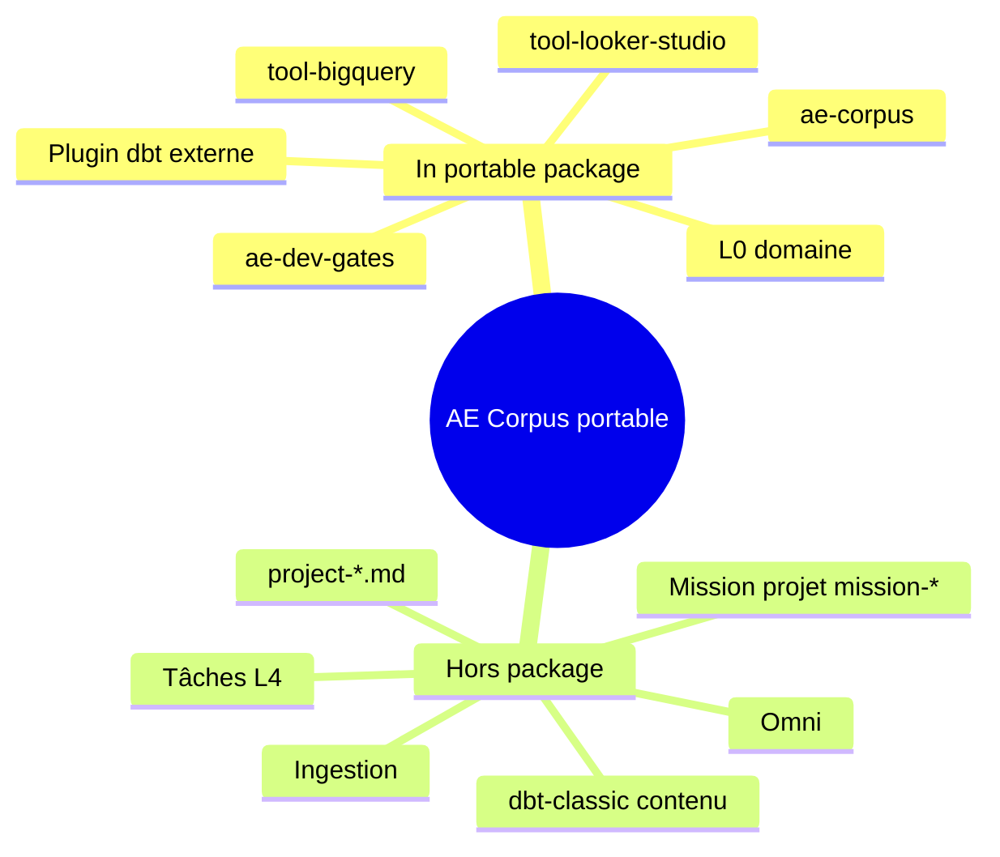

# AE Corpus — documentation graphique

## Vue top → bottom

L3 / L4 sont des **emplacements** : chaque dépôt a sa propre mission (`mission-*`)
et ses tâches. Le package portable ne les contient pas.

## Flux d’une session

## Remplacement de dbt-classic

## Périmètre phase actuelle

