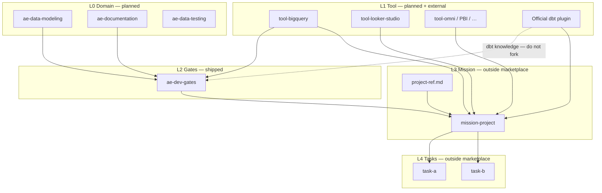
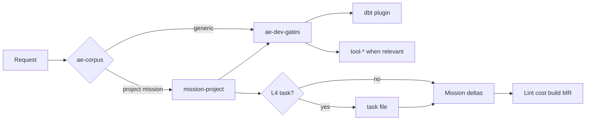
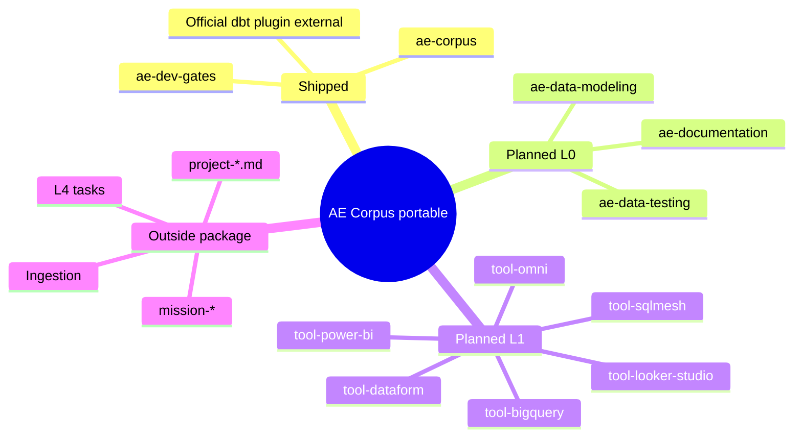

# AE Corpus — architecture diagrams

Nodes marked **(planned)** are catalogued but not yet on disk in this package.
Only `ae-corpus` and `ae-dev-gates` are shipped today.

## Top → bottom view

L3 / L4 are **slots**: each repo owns its mission (`mission-*`) and tasks.
The portable package does not contain them.

## Session flow

## Package scope (shipped vs planned)

